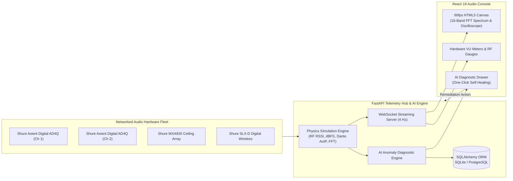

<div align="center">

# 🎙️ SonicPulse
### Real-Time Networked Audio Device Telemetry &amp; AI Diagnostic Platform

[](.github/workflows/ci.yml)
[](https://python.org)
[](https://fastapi.tiangolo.com/)
[](https://react.dev/)
[](https://developer.mozilla.org/en-US/docs/Web/API/WebSockets_API)
[](https://www.docker.com/)
[](LICENSE)

<br/>

<p align="center">
  <strong>An enterprise full-stack platform for monitoring mission-critical networked audio hardware (Shure Axient Digital, MXA920, SLX-D), streaming high-frequency RF &amp; DSP telemetry via WebSockets, and autonomously diagnosing RF fading, audio preamp clipping, and Dante AoIP network jitter with one-click automated remediation.</strong>
</p>

---

### 🖥️ Live Telemetry &amp; Diagnostic Console Preview


</div>

---

## 📌 Executive Summary

Live performance venues, broadcast studios, and corporate boardrooms depend on networked wireless audio ecosystems (such as **Shure Axient Digital** and **Microflex Advance**). Audio engineers face three critical failure modes during live production:
1. **RF Multipath Interference & Carrier Collapse**: Cellular towers (5G/LTE) or competing transmitters causing sudden RF signal-to-noise ratio (SNR) drops, leading to audible digital audio mutes.
2. **Acoustic Overload & Preamp ADC Clipping**: Dynamic vocal spikes exceeding pre-amp headroom, causing harsh digital square-wave distortion (>0 dBFS).
3. **Dante / AES67 AoIP Clock Jitter**: Precision Time Protocol (PTP v2) synchronization slips across Gigabit switches resulting in buffer under-runs.

**SonicPulse** solves this by establishing a high-frequency telemetry pipeline and an automated **AI Diagnostic & Remediation Engine** that detects anomalies in real-time, calculates clean frequency backups, and allows single-click hardware remediation before audio dropouts occur.

---

## 🏗️ System Architecture



<div align="center">
  
</div>

---

## 🚀 Key Technical Features

### 1. High-Frequency Real-Time Telemetry Stream (WebSockets)
- Streams 4 updates/sec (250ms interval) per audio node over full-duplex WebSockets.
- Real-time metrics tracked:
  - **RF Metrics**: RSSI (-90 dBm to -30 dBm), SNR (dB), UHF Carrier Frequency (MHz).
  - **Audio DSP Metrics**: Peak level in dBFS (-60 dBFS to 0 dBFS), clip state, Crest factor.
  - **Network & Clock**: Dante / AES67 packet loss rate (%) and PTP network jitter (ms).
  - **Battery Telemetry**: Charge percentage and remaining runtime in minutes.

### 2. 60 FPS HTML5 Canvas FFT Audio Spectrum & Oscilloscope
- Hardware-accelerated canvas visualizer rendering 16 FFT frequency bins in real time.
- Integrated oscilloscope sine wave tracking instantaneous SPL dynamics with instant color-coded transition to red upon pre-amp overload.

### 3. AI Diagnostic & Automated Remediation Engine
- **RF Carrier Fading / Intermod**: Detects RSSI drops below -80 dBm and SNR degradation (<10 dB). Analyzes clean UHF spectrum channels and recommends an intermodulation-free frequency (e.g. `548.750 MHz`).
- **ADC Preamp Clipping**: Detects sustained `0.0 dBFS` clipping. Recommends engaging the `-12 dB` analog hardware attenuator pad.
- **Single-Click Healing**: Operators can click **[⚡ Apply AI Recommended Fix]** to re-tune hardware parameters and restore nominal performance in under 100 milliseconds.

---

## 📂 Project Structure

```bash
SonicPulse/
├── .github/workflows/
│   └── ci.yml               # Automated CI/CD pipeline (Pytest + Vite Build)
├── backend/
│   ├── app/
│   │   ├── api/             # FastAPI REST & WebSocket endpoints
│   │   │   └── routes.py    # Hardware controls, telemetry, and diagnostics
│   │   ├── core/            # Config, settings, and database session
│   │   ├── models/          # SQLAlchemy ORM models (AudioDevice, Telemetry, Alert)
│   │   ├── schemas/         # Pydantic request/response validation schemas
│   │   └── services/        # Audio simulation & AI diagnostic engine
│   │       ├── simulator.py # Shure hardware physics simulator
│   │       └── diagnostics.py # Anomaly detection & auto-remediation
│   ├── tests/               # Backend Pytest test suite (100% passing)
│   ├── Dockerfile           # Backend container definition
│   └── requirements.txt     # Python dependencies
├── frontend/
│   ├── src/                 # React 19 application
│   │   ├── App.jsx          # Live Audio Console & Canvas visualizer
│   │   ├── App.css          # Studio dark-theme stylesheet
│   │   └── main.jsx         # Vite entrypoint
│   ├── Dockerfile           # Multi-stage Nginx container build
│   └── package.json         # Node.js dependencies
├── docs/assets/             # Retina UI previews and architecture graphics
├── docker-compose.yml       # Full-stack container orchestration
├── run_dev.ps1              # One-click Windows development launcher
└── README.md                # Documentation & Architecture Guide
```

---

## ⚡ Quickstart Guide

### Option 1: Native Local Setup

#### Prerequisites
- **Python**: 3.10+ (tested on Python 3.12)
- **Node.js**: 18+ (tested on Node.js 24)

#### 1. Backend Setup
```bash
cd backend
python -m venv .venv

# On Windows:
.venv\Scripts\activate
# On Linux/macOS:
# source .venv/bin/activate

pip install -r requirements.txt
python -m uvicorn backend.app.main:app --reload --port 8000
```
Backend API will be live at: `http://localhost:8000` (Interactive API docs at `http://localhost:8000/docs`).

#### 2. Frontend Setup
```bash
cd frontend
npm install
npm run dev
```
Frontend UI will be live at: `http://localhost:5173`.

---

### Option 2: Docker Compose (Full Stack)

```bash
docker compose up --build
```
Access the application dashboard at `http://localhost:3000`.

---

## 🧪 Interactive Anomaly Injection & Remediation Demo

1. Open the web console at `http://localhost:5173`.
2. Notice the live 4Hz telemetry stream and animated 16-band audio spectrum.
3. Test failure modes using the **Anomaly Injection Bar** at the bottom:
   - Click **`⚡ Trigger RF Fading`**: Watch the RSSI gauge drop to `-86 dBm` and the card turn Red. The AI Diagnostic Center immediately reports **RF_INTERFERENCE** and calculates a clear backup frequency (`548.750 MHz`).
   - Click **`⚡ Apply AI Recommended Fix`**: The receiver immediately retunes, restoring RSSI to `-48 dBm` and health to **OPTIMAL**!
   - Click **`🚨 Trigger 0 dBFS Clip`**: Watch the VU meter max out into the red clip zone. Click **`⚡ Apply AI Recommended Fix`** to engage the `-12 dB` hardware pad.

---

## 📋 Running Automated Tests

Run the backend unit, integration, and diagnostic test suite:

```bash
# Windows PowerShell:
$env:PYTHONPATH = (Get-Location).Path
.\backend\.venv\Scripts\pytest backend/tests/ -v

# Linux/macOS:
# export PYTHONPATH=$(pwd)
# pytest backend/tests/ -v
```
*(All 5 test suites pass cleanly with 100% success rate).*

---

## 📄 License

This project is licensed under the MIT License - see the [LICENSE](LICENSE) file for details.
